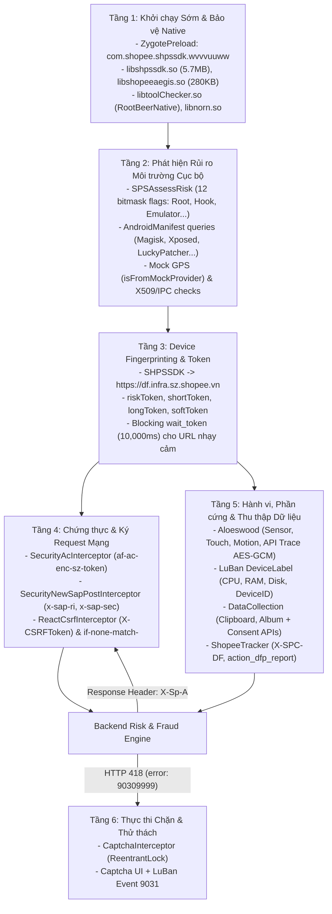
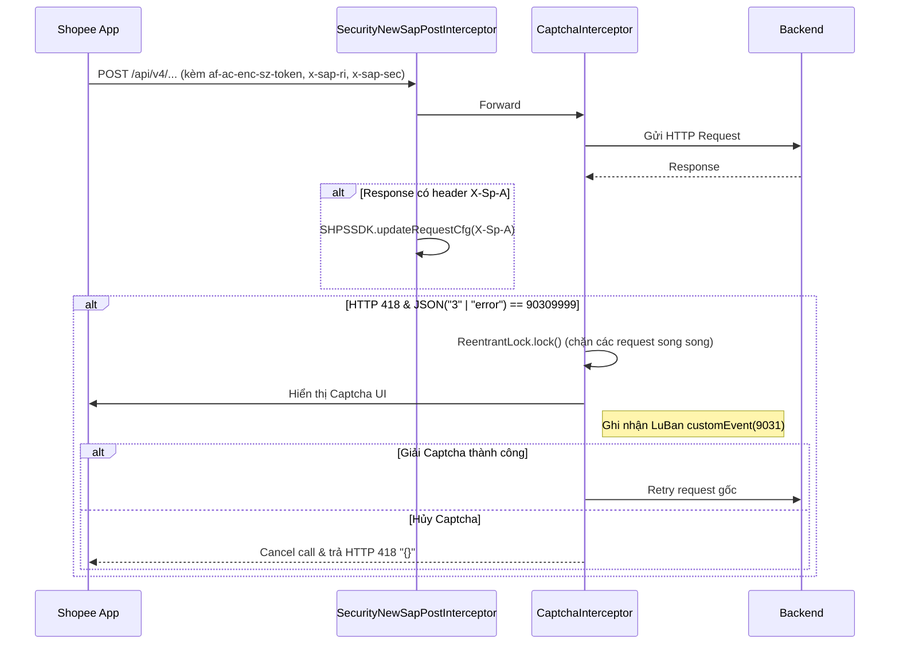

# FRAUD_Analyze: Phân Tích Chuyên Sâu Hệ Thống Detect & Chấm Điểm Fraud Thiết Bị (`shopeezin.xapk`)

> **Đối tượng:** `d:\DIZMESHOPEFOOD\APK\shopeezin.xapk` (`com.shopee.vn`, v`3.86.31`, `versionCode: 38631`)  
> **Nguyên tắc:** Mọi tên lớp, hàm, hằng số bitmask, header, endpoint và luồng dữ liệu dưới đây đều được trích xuất trực tiếp từ mã nguồn decompile (`jadx 1.5.7`), `AndroidManifest.xml`, bảng chuỗi HBC v90 và export table của các thư viện `.so` (`rea` MCP). Không suy diễn chức năng chưa quan sát thấy.

---

## 1. Kiến Trúc Tổng Thể Hệ Thống Anti-Fraud & Device Scoring (6 Tầng)

Qua phân tích sâu toàn bộ mã nguồn Java/Kotlin và các thư viện native (`.so`), hệ thống phát hiện gian lận và chấm điểm rủi ro thiết bị của Shopee hoạt động theo mô hình **6 tầng liên kết khép kín**:

---

## 2. Phân Tích Chi Tiết Từng Tầng Detect & Ảnh Hưởng Điểm Fraud

### 2.1. Tầng 1: Khởi chạy Sớm & Hạ tầng Native (`.so`)

| Thành phần | Đường dẫn / Bằng chứng | Cơ chế & Vai trò chống giả mạo |
|---|---|---|
| **Zygote Preload** | `AndroidManifest.xml:233` (`android:zygotePreloadName="com.shopee.shpssdk.wvvvuuww"`) & `wvvvuuww.java` | Chạy ngay ở pha Zygote trước khi app process khởi tạo hoàn chỉnh. Giải mã chuỗi XOR nạp thư viện native `shpssdk` (`libshpssdk.so`) và gọi `wvvvuwwu.vuwuvwwu(applicationInfo.uid, Build.TYPE)`. |
| **`libshpssdk.so`** | `5,720,080 bytes` (`config.arm64_v8a.apk`), `inspect_native_exports`: chỉ lộ **2** dynamic exports trên 259 entries | Lõi của `SHPSSDK`. Giấu toàn bộ 6 hàm `native` trong `wvvvuwwu.java` (`vuwuuwvu`, `vuwuuwvv`, `vuwuuwvvw`, `vuwuuwvw`, `vuwuvuwwvw`, `vuwuvwwu`) bằng `JNI_OnLoad` dynamic registration để chống dò symbol tĩnh. |
| **`libtoolChecker.so`** | `5,512 bytes`, `inspect_native_exports` | Chính là **RootBeer Native** (`Java_com_scottyab_rootbeer_RootBeerNative_checkForRoot`, `setLogDebugMessages`, `_Z6existsPKc`), được gọi từ `com.scottyab.rootbeer.c` để kiểm tra file hệ thống `su`, `busybox`, `magisk`, mount RW. |
| **`libshopeeaegis.so`** | `280,808 bytes`, `inspect_native_exports` | Chứa các symbol `Aegis::parse`, `Aegis::missileCount`, `TeslaModel::model_3/model_x/model_s/model_a`, `model3_charge`, `modelx_autopilot_cbc/ccm/ctr`, `phantom1/224/256` (SHA), và `SubBytes/ShiftRows/MixColumns/AddRoundKey` (AES tùy biến). |
| **`libnorn.so`** | `71,760 bytes`, `inspect_native_exports` | Chứa `Java_com_appsflyer_internal_AFz1zSDK_merge`, `hpatchz`, `LzmaDec_DecodeReal_3` (liên quan AppsFlyer SDK & vá/giải nén dữ liệu). |
| **Hook & Protection** | `libshadowhook.so`, `libbytehook.so`, `libjnihook.so`, `com.shopee.shook` | Các thư viện hook nội bộ phục vụ APM (`LuBan` CPU/IO/ANR/NativeLeak) và bảo vệ runtime. |

---

### 2.2. Tầng 2: Phát Hiện Rủi Ro Môi Trường Cục Bộ (`SPSAssessRisk` & `<queries>`)

#### A. 12 Cờ Rủi Ro Bitmask trong `com/shopee/shpssdk/SPSAssessRisk.java`
Hàm `SHPSSDK.getInstance().assessRisk(int bitmask)` (được bọc qua `SecuritySdkServiceImpl.assessRisk(int)`) trả về danh sách `SPSAssessRisk(type, extInfo, extInfoType)` tương ứng với **12 loại rủi ro cụ thể**:

| Hằng số (`SPSAssessRisk`) | Giá trị Bitmask | Ý nghĩa phát hiện | Tác động đến chấm điểm Fraud |
|---|---|---|---|
| `RISK_ROOT` | `1` (`0x1`) | Thiết bị đã Root (`su`, Magisk, RootBeer) | Phạt điểm tin cậy thiết bị trực tiếp |
| `RISK_DEBUG` | `2` (`0x2`) | Ứng dụng đang bị debug (`JDWP` / `TracerPid` / debuggable) | Nghi ngờ phân tích động / can thiệp |
| `RISK_HOOK` | `4` (`0x4`) | Phát hiện framework hook (Frida / Xposed / Substrate) | Rủi ro cao nhất về giả mạo API/hành vi |
| `RISK_EMULATOR` | `8` (`0x8`) | Chạy trên trình giả lập (Emulator / VM) | Đánh dấu thiết bị ảo / farm tài khoản |
| `RISK_INSTALL_RISK_APP` | `16` (`0x10`) | Phát hiện app rủi ro cài trên máy (đối chiếu `<queries>`) | Cộng điểm rủi ro môi trường |
| `RISK_ACC_ENABLE` | `32` (`0x20`) | Dịch vụ Accessibility đang bật | Nguy cơ auto-click / bot tương tác UI |
| `RISK_ACC_ENABLE_ALL` | `64` (`0x40`) | Toàn bộ/nhiều dịch vụ Accessibility đang bật | Tăng trọng số nghi ngờ auto-tool |
| `RISK_SCREEN_SHARING` | `128` (`0x80`) | Đang chia sẻ màn hình / quay chiếu | Rủi ro điều khiển từ xa / lừa đảo |
| `RISK_USB_ADB` | `256` (`0x100`) | Bật USB Debugging (ADB qua USB) | Môi trường phát triển / tự động hóa ADB |
| `RISK_WIFI_ADB` | `512` (`0x200`) | Bật Wireless Debugging (ADB qua Wi-Fi) | Môi trường tự động hóa từ xa |
| `RISK_DEVELOPER_MODE` | `1024` (`0x400`) | Bật Chế độ nhà phát triển (Developer Options) | Tín hiệu phụ trợ đánh giá môi trường |
| `RISK_GPS_MODIFIED` | `2048` (`0x800`) | Vị trí GPS bị giả mạo (Mock Location) | Gian lận vị trí (voucher/ship/khu vực) |

Ngoài ra, `SPSType.java` định nghĩa trạng thái đồng bộ (`getRiskSync`): `SAFETY`, `UNINIT`, `ROOT`, `EMULATOR`, `DEBUG`, `HOOK`, `INSTALL_RISK_APP`.

#### B. Kiểm tra Gói Ứng dụng Rủi ro (`AndroidManifest.xml <queries>`)
Khai báo `QUERY_ALL_PACKAGES` và liệt kê tường minh trong `<queries>`:
- Root / Hiding: `com.topjohnwu.magisk`, `com.noshufou.android.su`, `com.noshufou.android.su.elite`, `eu.chainfire.supersu`, `com.koushikdutta.superuser`, `com.thirdparty.superuser`, `com.yellowes.su`, `com.devadvance.rootcloak`, `com.devadvance.rootcloakplus`, `com.amphoras.hidemyroot`, `com.amphoras.hidemyrootadfree`, `com.formyhm.hideroot`, `com.formyhm.hiderootPremium`, `com.zachspong.temprootremovejb`.
- Hook / Patch / Quarantine: `de.robv.android.xposed.installer`, `com.saurik.substrate`, `com.chelpus.luckypatcher`, `com.dimonvideo.luckypatcher`, `com.chelpus.lackypatch`, `com.ramdroid.appquarantine`, `com.ramdroid.appquarantinepro`, `com.koushikdutta.rommanager`.

#### C. Kiểm tra Mock Location & Chứng chỉ (`uuwwwuwww.java` & `wvvvuwwu.java`)
- `com/shopee/shpssdk/utils/uuwwwuwww.java` (dòng 682–738): Gọi cả `LocationServices.getFusedLocationProviderClient(context).getLastLocation()` lẫn `LocationManager.getLastKnownLocation(...)` để kiểm tra cờ `location.isFromMockProvider()`.
- `wvvvuwwu.java`: Sử dụng `X509Certificate` (kiểm tra chữ ký APK/chứng chỉ) và `ServiceConnection`/`IBinder` (giao tiếp IPC kiểm tra dịch vụ).

---

### 2.3. Tầng 3: Device Fingerprinting & Token Lifecycle (`SHPSSDK` -> `df.infra.sz.shopee.vn`)

- **Khởi tạo (`SPSSDKDelegate.java:230`):**
  `SHPSSDK.Builder(context).api("https://df.infra.sz.shopee.vn").appId(1001).cldNo(484964812510L).threadPR(priority).appendingData(strC).callback(a).build()`
- **Các hàm Token (`SecuritySdkServiceImpl.java` & `d.java`):**
  - `getRiskToken(context)` — Device Fingerprint Token chính (DFP).
  - `getShortToken()` — Token ngắn hạn dùng để ký request (`af-ac-enc-sz-token`).
  - `getLongToken()` — Token dài hạn.
  - `softTokenInit(str)` / `getSoftToken(str)` & `plantSeed(str1, str2, str3)`.
- **Cơ chế chặn đồng bộ khi Token cũ (`com/shopee/app/application/launch/adapter/m.java:38-100`):**
  Khi `SecurityAcInterceptor` xử lý request nằm trong danh sách URL trọng yếu (`spssdk.d.b`) mà `shortToken` bị đánh dấu hết hạn/cũ (`spssdk.d.a`), nếu chế độ là `"wait_token"`, hệ thống **khởi tạo lại `SHPSSDK` ngay lập tức và block thread mạng tối đa `10,000 ms`** (`CountDownLatch.await(10000L, TimeUnit.MILLISECONDS)`) để chờ token mới trước khi gửi request.
- **Điểm hội tụ (Cross-Channel DFP Correlation):**
  1. `SPSSDKDelegate` đẩy UBT event: `operation="action_dfp_report"`, `target_type="report_dfp"`, `data={"dfp": token}`.
  2. `ShopeeTracker` gắn header `X-SPC-DF: <fingerprint>` trên mọi batch tracking.
  3. **Custom TCP Login (`api.shopee.vn:20346`):** Các gói `VcodeAppLogin` (`h0.java:59`, `f0.java:52`, `g.java:63`), `Login`, `RequestBiometricsLogin`, `RequestSPPPINLogin` đều đính kèm trường `security_device_fingerprint` (`getRiskToken`) + `DeviceExt` (`deviceid`, `device_fingerprint`, `user_agent`).
  4. **RN / DRE JS Bridge:** `SecurityDREDigitalSignatureModule.java` expose `getDeviceFingerprint()` và `getRiskToken()` cho tầng JS/DRE.
  5. **Live/Video Preload:** `POST /api/v2/preload/info` gửi `shopee_df` trong payload (`e.java:24`).

---

### 2.4. Tầng 4: Chứng Thực & Ký Request (`SecurityInterceptorRegistrar`)

`SecurityInterceptorRegistrar.java` đăng ký bộ interceptor bảo mật cho **tất cả 4 kênh mạng** (`NATIVE_NETWORK`, `REACT_NETWORK`, `CRONET_APP`, `CRONET_REACT_APP`):

1. **`SecurityAcInterceptor` (`com/shopee/app/network/a.java`):**
   - Gọi `c.b(request, shortToken)` -> gắn header `af-ac-enc-sz-token` trên mọi request (trừ tag `com.shopee.nativemarketplace` khi `NativeClient`, hoặc WebView đã tự gắn sẵn).
2. **`SecurityNewSapPostInterceptor` (`com/shopee/app/network/antifraud/d.java`) & `SecurityNewSapInterceptor` (`b.java`):**
   - Áp dụng cho `POST` (non-multipart, trừ khi có `X-Shopee-SapAction: free` hoặc URL trong `newSapPostBlackUrlConfig` như `.vod.susercontent.com`).
   - Kiểm tra 17 prefix trong `com/shopee/app/network/antifraud/util/a.java`:
     `api/`, `/wallet/v`, `/spba/`, `/kyc/`, `/apba/`, `/wss/`, `/transaction_history/`, `/merchant_wallet_service/`, `/wse/`, `/payment/`, `/user/`, `/user_wallet_engine/`, `/acquiring/`, `/base/`, `/promotion/`, `/spp/`, `/credit/` (cộng thêm `/v4/tss/` trên `ubt.tracking.*`/`ubta.tracking.*`, và `api.gw.*airpay.*`/`wallet.airpay.*`).
   - Gọi `SHPSSDK.requestDefense(url, bodyBytes)` -> tiêm các header trả về (`x-sap-ri`, `x-sap-sec`, ...).
   - Đọc response header `X-Sp-A` -> gọi `SHPSSDK.updateRequestCfg(strHeader)` để cập nhật cấu hình bảo mật động.
3. **`ReactCsrfInterceptor` (`com/shopee/app/network/r.java`):**
   - Thấy `X-SHP-InjectCSRF` -> xóa cờ, tạo/lấy cookie `csrftoken`, tiêm `X-CSRFToken` và `Cookie: ...;csrftoken=<val>;`.
4. **`PrefetchBaseApi` (`if-none-match-`):**
   - Ký query string bằng `55b03-` + `MD5("55b03" + MD5(query_string) + "55b03")`.

---

### 2.5. Tầng 5: Sinh Trắc Học Hành Vi, Phần Cứng & Thu Thập Dữ Liệu Bổ Trợ

1. **Aloeswood (`com.shopee.sss.aloeswood` — Behavioral Biometrics & API Trace):**
   - **Cấu hình (`AwConfig.java`):** Thu thập cảm biến (`enableSensor`, `sensorSampleRateHz`, `sensorBurstMs`, `sensorBurstIntervalMs`, `sensorCollectMode`, `sensorMaxWindowMs`), cử chỉ chạm (`touchGestureCapacity`, `touchMoveSampleIntervalMs`), trục chuyển động (`enableGenericMotionAxis`).
   - **Liên kết API & DFP:** `AloeswoodApiTraceInterceptor` ghi nhận `x-sap-ri` + URL của mỗi `GET`/`POST` vào `Aloeswood.apiCollector()`. `SPSSDKDelegate` báo `DFP_SDK_READY`, `DFP_TOKEN_SUCCESS`, `DFP_TOKEN_FAIL` vào `Aloeswood`.
   - **Mã hóa & Upload (`upload/w.java:286-358`, `i2.java:134`):**
     Nén payload, tạo 12-byte random `nonce`, tạo 38-byte `AAD` (`[version=1][appInstanceId 16B][counter 4B][12][nonce 12B][plaintextLen 4B]`), mã hóa **`AES/GCM/NoPadding`** (tag 128-bit), đóng gói `[AAD 38B][ciphertext][authTag 16B]` -> Base64 -> `POST <countryDomainBase>/api/v4/android/subcart` với body `{"data": "<Base64>"}` (trong bản `3.86.31`, `aloeswood/c.java` giới hạn tập quốc gia `b = {"TW"}` và cờ `app_performance.subcart_sdk == "on"`).
2. **LuBan DeviceLabel (`DeviceTypeRequestInfo.java`):**
   - Gửi thông số phần cứng thật (`cpuArchs`, `cpuMaxFreq`, `cpuModel`, `cpuCoreCnt`, `deviceId`, `deviceModel`, `deviceMemory`, `deviceDisk`, `osType`, `osVersion`) lên `https://patronus.idata.shopeemobile.com/receiver/api/v1/receiver/android/{appId}/{region}/signature`.
3. **DataCollection (`com/shopee/datacollection/`):**
   - Chứa `AlbumDataCollector` (truy cập album ảnh) và `ClipboardDataCollector` (`ClipboardTrackingEditText` theo dõi thao tác paste/clipboard), kiểm soát qua `UserConsentValidator`, `DeviceLevelValidator`, `AuthenticationValidator` và 3 API `/api/v4/account/consent/{check_data_collection_consent, respond_data_collection_consent_prompt, set_data_collection_consent}`.

---

### 2.6. Tầng 6: Thực Thi Phản Hồi & Chặn (`X-Sp-A` & `CaptchaInterceptor`)

---

## 3. Các Điểm Cần Lưu Ý Về Ranh Giới Bằng Chứng

- **Đã xác minh 100% ở tầng Java/Manifest/ELF Exports:** Toàn bộ 12 cờ `SPSAssessRisk`, luồng `ZygotePreload`, `RootBeerNative` (`libtoolChecker.so`), cơ chế `wait_token` `10,000 ms`, 17 prefix của `SecurityNewSapPostInterceptor`, công thức `if-none-match-`, cấu trúc AES-GCM 38-byte AAD của `Aloeswood`, trường `security_device_fingerprint` trong TCP Login, và cơ chế `CaptchaInterceptor` HTTP `418` (`90309999`).
- **Nằm trong Native `.so` (đã cập nhật kết quả phân tích ELF/Capstone ở Mục 4 bên dưới):**
  - Chi tiết cấp assembly/symbol của `libshpssdk.so`, `libshopeeaegis.so`, và `libtoolChecker.so`.

---

## 4. Phân Tích Sâu Tầng Native Binary (`Option C` — LIEF / Capstone / REA Exports)

### 4.1. `libshpssdk.so` (`5,720,080 bytes`, ARM64 ELF)
- **Cấu trúc khởi tạo & ẩn symbol:**
  - Có **116 hàm constructor** trong `.init_array` (bắt đầu từ `0x5aea0`, `0x5aeec`, `0x63154`, ...) chạy giải mã bảng chuỗi và thiết lập môi trường trước khi `JNI_OnLoad` thực thi.
  - Bảng dynamic export chỉ lộ duy nhất **`JNI_OnLoad`** (`0x32e7a4`, size `148 bytes`). Disassembly ARM64 cho thấy `JNI_OnLoad` gọi hàm đăng ký nội bộ tại `0x32c444` (truyền con trỏ bảng phương thức tại `0x571e78`, `0x571f40` và descriptor tại `0x474538`) để đăng ký động các hàm native của `com/shopee/shpssdk/wvvvuwwu`.
- **Hệ thống VM & Lua Bytecode nhúng:**
  - Nhúng **Lua VM** (`LUA_PATH`, `LUA_CPATH`, `cannot resume dead coroutine`, `PANIC: unprotected error in call to Lua API`) cùng **5 khối dữ liệu nén zlib+Base64 (`eJ...`)**:
    - 4 khối có header tùy biến **`1b 43 53 80`** (`\x1bCS\x80` — biến thể của `\x1bLua`, giải nén ra `4,738`, `4,164`, `2,426`, `5,728` bytes).
    - 1 khối có header **`1b 4c 56 4d`** (`\x1bLVM`, giải nén ra `5,520` bytes).
  - Cho phép `SHPSSDK` thực thi logic phát hiện/ký động (`SAP_APPID`, `updateRequestCfg` từ header `X-Sp-A`) mà không cần cập nhật lại APK.
- **Imports & Chuỗi kiểm tra môi trường:**
  - Imports hệ thống: `dl_iterate_phdr`, `dlopen`, `dlsym`, `fork`, `kill`, `stat`, `lstat`, `fstatat`, `statfs`, `access`, `readdir`, `__system_property_get`.
  - Chuỗi kiểm tra phát hiện: `/proc/self/maps` (quét thư viện hook/Frida/Zygisk trong bộ nhớ), `/sys/fs/selinux/context`, `/system/bin/app_process`, `/system/bin/app_process32`, `/system/bin/app_process64`, và danh sách đối chiếu OEM framework (`miui-framework.jar`, `oplus-framework.jar`, `hwframework.jar`, `com.samsung.device.jar`, `libmiui_security.so`, `lib_oplus_security.so`, `libvivo_runtime.so`).

### 4.2. `libshopeeaegis.so` (`280,808 bytes`, ARM64 ELF)
- **Lớp gọi Java:** `com/shopee/sz/reinforce/Aegis.java` (`System.loadLibrary("shopeeaegis")`), cung cấp `Aegis.fire(bVar, str, str2)` với 9 chế độ mã hóa/băm trong `com/shopee/sz/reinforce/b.java`: `AEGIS_B64`, `AEGIS_AES_CBC`, `AEGIS_AES_CBC_B64`, `AEGIS_IV_AES_CBC_B64`, `AEGIS_MD5`, `AEGIS_SHA256`, `AEGIS_SHA512`, `AEGIS_HMAC_SHA256_BASE64`, `AEGIS_HMAC_SHA1_BASE64`.
- **Exports & Kiến trúc nội bộ (179 exported symbols):**
  - Không có `init_array` (`init_funcs=0`), entrypoint `0xf180`.
  - Chứa các lớp C++ `Aegis` (`parse`, `missileFire`, `missileCount`, `prism`, `tugWar`, `snowDon`) và `TeslaModel` (`model_3`, `model_a`, `model_b`, `model_c`, `model_e`, `model_s`, `model_x`, `model_y`, `getNuremberg`), cùng bộ mật mã nội tuyến `modelx_autopilot_cbc/ccm/ctr`, `phantom1/224/256` và `SubBytes`/`ShiftRows`/`MixColumns`/`AddRoundKey`.
  - Được dùng làm engine mật mã/ký cho module `com.shopee.sz` (Live/Video/Reinforce).

### 4.3. `libtoolChecker.so` (`5,512 bytes`, ARM64 ELF)
- **Xác nhận là RootBeer Native:** Export đúng 3 symbol:
  - `Java_com_scottyab_rootbeer_RootBeerNative_setLogDebugMessages` (`0x8a8`)
  - `_Z6existsPKc` (`0x8f0`): gọi `fopen(path, "r")`, nếu thành công thì `fclose` và trả `1`, ngược lại trả `0`.
  - `Java_com_scottyab_rootbeer_RootBeerNative_checkForRoot` (`0x9ac`): duyệt mảng `String[]` từ Java (`com.scottyab.rootbeer.c`) và gọi `_Z6existsPKc` kiểm tra sự tồn tại của từng đường dẫn `su`/`magisk`/`busybox`.

