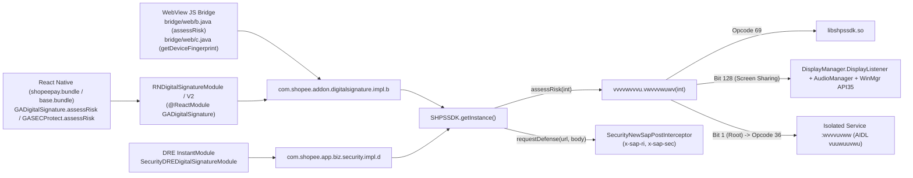

# Vòng 2 (Option B): Truy Vết Luồng `assessRisk()` / Checkout & Đối Chiếu Phiên Hủy Đơn `249036761217534`

> **Đối tượng mã nguồn:** `d:\DIZMESHOPEFOOD\APK\shopeezin.xapk` (`com.shopee.vn` v`3.86.31`, `versionCode: 38631`)  
> **Đối tượng phiên thực tế:** `d:\DIZMESHOPEFOOD\NetworkCapture\REPORT ORDER.md` (đơn `249036761217534`, `sn=261122127J7AFX`, `checkout_id=249036761214420`)  
> **Nguyên tắc:** Mọi tên lớp, hàm, hằng số, chuỗi HBC, và dòng log đều được trích xuất trực tiếp từ mã nguồn decompile, `bundle_v9`, và `REPORT ORDER.md`.

---

## 1. Chuỗi Gọi Từ JS / Web / DRE Xuống `SHPSSDK` & Native

### 1.1. Tầng JavaScript / Hermes (`bundle_v9`)
Quét trực tiếp 16 file `.bundle` (Hermes HBC v90) trong `shopeezin-extracted/bundle_v9`:
- **`shopeepay.bundle`** (`20,612,836` bytes):
  - `@0x221979`: `GADigitalSignature.assessRisk` (nằm cạnh chuỗi UI `ScamWarning20OnlyIcon`).
  - `@0x2f9f97`: `GASECProtect.assessRisk`.
  - `@0x3587dd`: `getRiskToken`, `@0x376644`: `getDeviceFingerprint`.
  - `place_order` (9 vị trí, gồm `is_place_order_screenshot_start`, `payment_fe_as_place_order_bring_up_pin_btn_text`, `payment_fe_as_place_order_payment_method_label`, `as_place_order_use_2fa_module`).
- **`base.bundle`**, **`base73.bundle`**, **`marketplace-platform.bundle`**: chứa `GADigitalSignature`, `getDeviceFingerprint`, `getRiskToken`.
- **`product-page.bundle`**: chứa `getDeviceFingerprint`, `place_order`.

### 1.2. Tầng Bridge Java/Kotlin
- **React Native (`RNDigitalSignatureModule.java` & `RNDigitalSignatureModuleV2.java`):**
  - `@ReactModule(name = "GADigitalSignature")`, đăng ký qua `com.shopee.app.biz.security.impl.c`.
  - `assessRisk(String str, Promise)` giải mã JSON `DigitalSignatureAssessRiskRequest(risks)` (`proto/a.java`), gọi `provider.i(risks)` -> `SHPSSDK.getInstance().assessRisk(i)`, trả về `DigitalSignatureAssessRiskResponse(assessRisk)` (`proto/b.java`).
- **WebView (`com/shopee/addon/digitalsignature/bridge/web/`):** `b.java` (`getModuleName() = "assessRisk"`), `c.java` (`"getDeviceFingerprint"`).
- **DRE (`SecurityDREDigitalSignatureModule.java`):** `MODULE_NAME = "DREDigitalSignature"`, expose `getDeviceFingerprint` và `getRiskToken`.

---

## 2. Cơ Chế Chấm Rủi Ro Trong `SHPSSDK` (`vvvvwvvvu.java` & `vwwwvvuwv.java`)

### 2.1. Luồng `vvvvwvvvu.vwvvvwuwv(int i)` (`assessRisk`)
1. **Gọi Native (`libshpssdk.so`):** `wvvvuwwu.uwuuuuwuw(69, i + "")` trả về `JSONArray` gồm `{t: type, e: extInfo, et: extInfoType}`.
2. **Cross-check phía Java (nếu native chưa đánh cờ):**
   - **Bit `128` (`RISK_SCREEN_SHARING`):**
     - `DisplayManager.registerDisplayListener(this, null)` lắng nghe `onDisplayAdded` / `onDisplayChanged` / `onDisplayRemoved`.
     - Khi `displayId != 0`: dùng reflection kiểm tra `display.getType() == 5` (`TYPE_VIRTUAL`), `display.getState() == 2` (`STATE_ON`), `(display.getFlags() & 128) == 0`; lưu lại `getName()`, `getOwnerPackageName()`, `getType()`, `getFlags()`, `getState()` vào `uvuvuwwuu`.
     - Kết hợp kiểm tra `AudioManager.getMode() == 3` (`MODE_IN_COMMUNICATION`) và trên Android 15 (API >= 35) đăng ký callback `WindowManager` (`uvwuwuvww == 1`).
   - **Bit `1` (`RISK_ROOT`):** Gọi AIDL `vuuwuuvwu.vvwvvwuuu(36)` sang **tiến trình service riêng `:wvvvuvww`** (`com.shopee.shpssdk.wvvvuvww`, khai báo tại `AndroidManifest.xml:1359-1362`) để kiểm tra root độc lập ngoài main process.
   - **Bit `4` (`RISK_HOOK`):** Gọi `wwvuvwuuw.wwuvvwwvv().uwuuuwuwu(null)`.
3. **Quét nền định kỳ mỗi `60,000 ms`:** `vvvvwvvvu` gọi `vwvvvwuwv(31)` (Root/Debug/Hook/Emulator/RiskApp) và `vwvvvwuwv(1952)` (`32+64+128+256+512+1024`: Accessibility, Screen Sharing, USB ADB, Wi-Fi ADB, Developer Mode).

### 2.2. Cơ chế quét Accessibility & IME (`vwwwvvuwv.java` & `uvuvuuwuu.java`)
- `vwwwvvuwv.vuvvuuwwv(context)` đọc đồng thời `AccessibilityManager.getEnabledAccessibilityServiceList(-1)` và `Settings.Secure.getString(..., "enabled_accessibility_services")`, cùng `getInstalledAccessibilityServiceList()`.
- `uvuvuuwuu` trích xuất từng service: `packageName`, `serviceName`, `label`, cờ `uuwvvuuwu = 1` nếu `packageNames` mục tiêu chứa `"shopee"` hoặc `"garena"`, `uid`, 3 segment đầu của `sourceDir`, và trường ẩn `ApplicationInfo.seInfo` (qua reflection).
- **Whitelist trong `vwwwvvuwv` (đã giải mã XOR):**
  - Prefix bỏ qua (`uuwvvwvwv`): `com.google.`, `com.android.`, `com.samsung.`, `com.xiaomi.`, `com.miui.`, `com.qihoo.`, `com.huawei.`, `com.daemon.`, `com.vivo.`, `com.oppo.`.
  - Substring bỏ qua (`vvuvvwuww`): `autoinstall`, `autofill`, `callrecord`.
  - Exact package bỏ qua (`wwvuvwvwv`): `com.alhiwar`, `com.bitspice.automate`, `com.llamalab.automate`, `com.vmuslimpro`.
- **IME auto bị nhắm (`vwvwuvvuv`, Base64+XOR):** **`触动精灵输入法`** (TouchSprite IME) và **`按键精灵输入法`** (Anjian/AutoTouch IME).

### 2.3. Ký Request `place_order`
`com/shopee/app/network/antifraud/util/a.java` liệt kê `"api/"` ở vị trí đầu tiên trong 17 prefix kích hoạt `SecurityNewSapPostInterceptor`. Do đó mọi request POST JSON tới `/api/v4/...` (bao gồm `place_order`) đều gắn chữ ký `x-sap-ri`, `x-sap-sec` (từ `libshpssdk.so` qua `requestDefense`) và `af-ac-enc-sz-token` (`SecurityAcInterceptor`).

---

## 3. Đối Chiếu Trực Tiếp Với Phiên Hủy Đơn `249036761217534` (`REPORT ORDER.md`)

### 3.1. Diễn biến đặt & hủy đơn tức thì
| Thời điểm (`REPORT ORDER.md`) | Dòng | Sự kiện xác thực |
|---|---|---|
| `15:52:41.536` | L4575 | Click `place_order_button` (`checkout_session_id = "AYjGLOgg99dxGhUCZv2D/..."`) |
| `15:52:42.453` | L4580 | `place_order_api_start` |
| `15:52:43.401–436` | L4584–L4588 | `place_order_api_done` -> `action_place_order_success`, sinh `checkoutid=249036761214420`, `order_id=249036761217534` |
| `15:52:45.425` | L4644 | `GET /api/v4/order/success/order_info?checkout_id=249036761214420...` trả `{"data": null, "error": 31300102, "error_msg": ""}` |
| `15:53:20.830` | L4863 | `GET /api/v4/order/get_order_detail_v2?order_id=249036761217534` xác nhận `"text": "odp_banner_cancelled_title"`, `"cancel_date": "1795337563"` (trước `osp_start` `1795337564461` ở L4646 đúng 1 giây), `"msg": {"text": "odp_banner_cancelled_cancel_by_system"}` |

### 3.2. Các tín hiệu bất thường ghi nhận trong cùng phiên
1. **239 sự kiện `[SCAM_DETECTION]` liên tục (L2801–L5044):**
   `Shopee Anti-Fraud event #1..#239: type=Accessibility, pkg=com.android.display.colorimeter, seq=664..1565` bắn đều đặn từ lúc mở `Settings` cho tới `checkout_page` và `order_detail`. (Dù `vwwwvvuwv` của `SHPSSDK` có whitelist prefix `com.android.`, hệ thống Anti-Fraud/UBT của Shopee vẫn ghi nhận trực tiếp `pkg=com.android.display.colorimeter` lên `event.db`).
2. **5 phiên `ContentRecordingSession` (`displayId=2..6`) (L411–L435):**
   `WindowManager` tạo liên tiếp 5 màn hình ảo mirror từ `displayId=0` lúc `15:26:02–06`. Đây là đúng loại `VirtualDisplay` (`TYPE_VIRTUAL = 5`) mà `DisplayManager.DisplayListener` trong `vvvvwvvvu.java` bắt được cho cờ `RISK_SCREEN_SHARING` (`128`).
3. **Bàn phím/Clipboard chạy qua `com.android.shell (uid=0)` (L1032–L1091):**
   `ActivityManager: Background started FGS: Allowed [callingPackage: com.android.shell; callingUid: 0; ... cmp=com.android.xwkeyboard/.ClipboardService]` tại `15:48:43` và `15:49:25`.
4. **Checksum `base.apk` lệch trong `ClassLoaderContext` (L2262):**
   `15:52:14.152`: `com.shopee.vn: ClassLoaderContext classpath element checksum mismatch. expected=1374452227, found=2606363195`.
5. **Bị kích hoạt Captcha chống bot ngay trước Checkout (L1722, L1767, L3965–L3971):**
   `15:50:52–15:51:10`: Chuyển hướng sang `/verify/captcha` và `/verify/traffic` với `target=tss_captcha`, `app_key="PDP.APP"`, `scenario="crawler_item"`.
