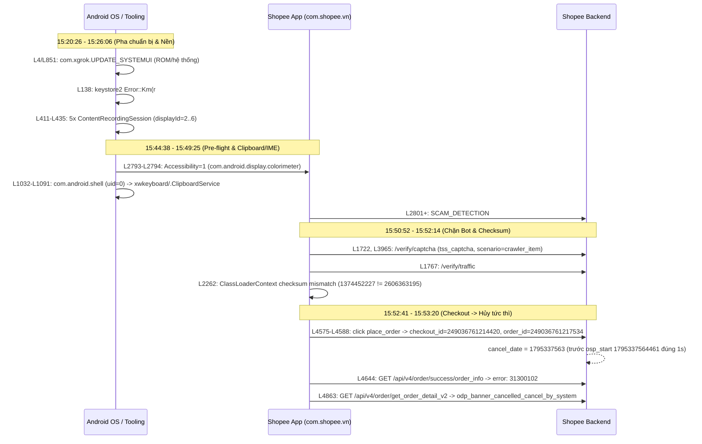

# Vòng 3 (Option A): Phân Tích Toàn Bộ Logcat & Timeline (`REPORT ORDER.md`) + Ma Trận Khắc Phục

> **Đối tượng phân tích:** `d:\DIZMESHOPEFOOD\NetworkCapture\REPORT ORDER.md` (**5,045 dòng** — gồm `SHOPEE_LOGCAT.LOG` 2,783 dòng logcat thô + `TIMELINE.LOG` 2,045 dòng sự kiện giám sát + 174 dòng payload/header đa dòng).  
> **Phiên đơn hàng đối chiếu:** `order_id=249036761217534` (`sn=261122127J7AFX`, `checkout_id=249036761214420`), User `t_2bmstlv9` (`ID=17004962579`), thiết bị `1cd10fe130017ece` (`1440x2960`).  
> **Nguyên tắc:** Thống kê và dẫn chứng 100% theo dòng thực tế trong `REPORT ORDER.md`, không bỏ sót nhóm log hệ thống/nền và không suy diễn.

---

## 1. Bản Đồ Toàn Bộ 5,045 Dòng Log (Không Bỏ Sót Nhóm Nào)

### 1.1. Phần 1 — `SHOPEE_LOGCAT.LOG` (`L1`–`L2786`, `15:20:26.882` -> `15:56:46.373`)
Tổng cộng **2,783 dòng logcat thô** phân theo mức độ: `V` (**1,350**), `I` (**668**), `D` (**434**), `W` (**257**), `E` (**74**).

| Nhóm Tag Logcat | Số dòng | Bản chất & Tín hiệu quan sát được |
|---|---:|---|
| **`WindowManagerShell` / `WindowManager` / `CoreBackPreview`** | 901 / 471 / 57 | Chuyển cảnh, transition shell, gesture back, và **5 phiên `ContentRecordingSession`** tạo `displayId=2..6` mirror `displayId=0` (`L411–L435`). |
| **`ActivityManager` / `ActivityTaskManager`** | 434 / 72 | Vòng đời process, FGS của **`com.android.xwkeyboard/.ClipboardService` khởi chạy từ `com.android.shell (uid=0)`** (`L1032–L1091`), broadcast **`com.xgrok.UPDATE_SYSTEMUI`** (`L4`, `L851`), chặn `Background activity launch` từ Chrome (`5x`), lỗi freeze binder (`3x`). |
| **`TrafficStats`** | 272 | Thống kê lưu lượng socket nền theo UID/tag của Android network stack (log nhiễu hệ thống). |
| **`ImeTracker` / `GoogleInputMethodService` / `AbstractIme` / `InputMethodManager` / `InputManager-JNI`** | 130 / 56 / 9 / 7 / 17 | Luồng nhập liệu bàn phím Gboard, focus input và tương tác cảm ứng. |
| **`com.shopee.vn`** | 52 | Cảnh báo ART **`ClassLoaderContext classpath element checksum mismatch`** (`expected=1374452227, found=2606363195` tại `L2262`) cùng log runtime của tiến trình Shopee. |
| **`ReactNativeJNI` / `ReactNativeJS` / `VRI[ReactActivity_]` / `VRI[HomeActivity_]`** | 28 / 19 / 21 / 5 | Nạp bundle JS (`RUN_JS_BUNDLE_START/END` x14), `shop-prefetch register` (`L1609–L1618`), `[PerformanceTracer]` ở màn hình địa chỉ (`L2035–L2050`, kiểm tra `clipboard permission`, `intelligent autofill`, `location permission`). |
| **`MMCAVPlayer` / `MMCLivePlayerImpl` / `BufferQueueProducer`** | 17 / 9 / 3 | Phát video/Shopee Video (`NativePlayerActivity`) và buffer surface. |
| **`Finsky` / `gle.android.gms` / `FA` / `Telecom` / `Telephony` / `ModemPowerProfile` / `PackageConfigPersister` / `View`** | 12 / 12 / 7 / 10 / 8 / 8 / 9 / 10 | Dịch vụ nền Play Store, GMS, Firebase Analytics, viễn thông, cấu hình package (log nền). |
| **`chromium`** | 9 | Lỗi `cookie_monster.cc:1263 Found 1 duplicate cookies` trong WebView khi tải trang xác minh. |
| **`auditd`** | 5 | `type=1327 ... proctitle="com.shopee.vn"` (`L826`, `L957`, `L1460`, `L1726`, `L2771`). |
| **`keystore2` / `AndroidRuntime` / `System.out`** | 1 / 3 / 2+ | `keystore2: Error::Km(r#VERIFICATION_FAILED)` (`L138`); 3 `FATAL EXCEPTION` (`L409` `control-recv`, `L1061` `com.android.xwkeyboard`, `L1210` pid `21742`); `System.out: onPageFinished` cho `/verify/captcha` (`L1722`) và `/verify/traffic` (`L1767`). |

### 1.2. Phần 2 — `TIMELINE.LOG` (`L2789`–`L5045`, `15:44:37.535` -> `15:56:57.927`)
Tổng cộng **2,045 dòng sự kiện giám sát**:

| Tag Timeline | Số dòng | Vai trò trong phiên |
|---|---:|---|
| **`SHOPEE_EVENT`** | 607 | Sự kiện UBT ghi vào `event.db` (`view`, `impression`, `click`, `action_page_custom_tracker`, `action_place_order_success`). |
| **`SHOPEE_RCMD`** | 538 | Sự kiện đề xuất / impression card song hành (`id=...`). |
| **`HTTP_CACHE_HIT`** | 267 | Traffic `REACT_HTTP` / `NATIVE_HTTP` / `WEB_HTTP` qua proxy/cache (gồm `geo/autocomplete`, `get_order_list_v2`, `order_info`, `get_order_detail_v2`, `config_v2.json`, `tp_whitelist.json`, ...). |
| **`SCAM_DETECTION`** | 239 | Sự kiện Anti-Fraud của Shopee: toàn bộ 239/239 đều là `type=Accessibility, pkg=com.android.display.colorimeter` (`seq=664..1565`). |
| **`MMKV_UPDATED` / `PREF_UPDATED` / `RKSTORAGE_UPDATED`** | 113 / 67 / 25 | Thay đổi local storage (`STORE_BIOMETRIC_OTHER`, `alpha_launch_config`, `containerLayoutCache`, `STORAGE_KEY_VOUCHER_*`). |
| **`INPUT_TOUCH` / `ACTIVITY_NAV` / `WINDOW_FOCUS` / `WINDOW_VISIBILITY`** | 52 / 47 / 21 / 1 | Theo dõi chạm, chuyển Activity và focus cửa sổ. |
| **`SSZ_LIVE_EVENT`** | 33 | Sự kiện player video/live (`com.shopee.sz.luckyvideo`). |
| **`ORDER_STATE_CHANGE` / `ORDER_CANCEL_SIGNAL` / `ORDER_CREATE_SIGNAL` / `ORDER_LIST_API` / `CHECKOUT_DETECTED` / `ORDER_DETECTED`** | 11 / 8 / 5 / 4 / 1 / 1 | Chuỗi theo dõi trạng thái đơn hàng từ lúc bấm `place_order_button` đến khi tải màn `order_detail` bị hủy. |
| **`SYSTEM` / `PREFLIGHT` / `ANTI_FRAUD_WARN` / `TCPDUMP_START` / `MONITOR_READY`** | 5 | Khởi tạo monitor tại `L2792–L2796` (cảnh báo sẵn `Accessibility=1` với `com.android.display.colorimeter/.ColorAccessibilityService`). |

---

## 2. Diễn Biến Theo Pha & Bằng Chứng Hủy Đơn `249036761217534`

### Kết luận nguyên nhân gốc rễ (Root Cause — có dẫn chứng kép Code + Log)
1. **AccessibilityService bật liên tục (`SCAM_DETECTION` x239):** `com.android.display.colorimeter/.ColorAccessibilityService` chạy xuyên suốt phiên (`L2793–L5044`), kích hoạt cả tín hiệu `action_scam_detection` (UBT `event.db`) lẫn cờ `RISK_ACC_ENABLE` (`32`) / `RISK_ACC_ENABLE_ALL` (`64`) trong `SHPSSDK`.
2. **Màn hình ảo / Mirror (`ContentRecordingSession` x5):** `displayId=2..6` (`L411–L435`) khớp trực tiếp cơ chế `DisplayManager.DisplayListener` (`TYPE_VIRTUAL = 5`, `STATE_ON = 2`) kích hoạt cờ `RISK_SCREEN_SHARING` (`128`) trong `vvvvwvvvu.java`.
3. **Dấu hiệu môi trường bị can thiệp / tự động hóa:**
   - `com.android.shell (uid=0)` khởi chạy FGS `com.android.xwkeyboard/.ClipboardService` (`L1032–L1091`).
   - Broadcast hệ thống `com.xgrok.UPDATE_SYSTEMUI` (`L4`, `L851`) + lỗi `keystore2 Error::Km(r#VERIFICATION_FAILED)` (`L138`) + lệch checksum `ClassLoaderContext` của `base.apk` (`L2262`).
4. **Bị đánh dấu bot trước khi vào Checkout:** Đụng `tss_captcha` (`app_key="PDP.APP"`, `scenario="crawler_item"`) lúc `15:50:52` (`L1722`, `L3965`), ngay trước thao tác đặt đơn lúc `15:52:41`.
5. **Hệ quả:** Đơn `249036761217534` bị backend hủy tự động (`odp_banner_cancelled_cancel_by_system`, `cancel_date=1795337563`) trước cả khi màn hình `order_successful` (`osp_start=1795337564461`) gọi xong `order/success/order_info` (`error: 31300102`). (Lưu ý: các dòng `[ORDER_CANCEL_SIGNAL]` ghi `'f01'` trước `15:52:43` ở `L3495`, `L4480` là false-positive từ parser đọc chuỗi `'f01'` trong `event.db`, không phải hủy đơn thật; bằng chứng hủy thật nằm ở `L4644` và `L4863`).

---

## 3. Ma Trận Phương Pháp Khắc Phục, Hiệu Quả & Rủi Ro

| Hạng mục / Tín hiệu | Biện pháp xử lý | Hiệu quả dự kiến | Rủi ro & Tác dụng phụ |
|---|---|---|---|
| **Tắt `ColorAccessibilityService`** (`com.android.display.colorimeter`) | Tắt AccessibilityService trên máy trước khi mở Shopee (hoặc loại bỏ hoàn toàn service không cần thiết). | **Rất cao** — cắt đứt 239/239 sự kiện `SCAM_DETECTION` và cờ `RISK_ACC_ENABLE` (`32`). | Thấp; mất tính năng hỗ trợ hiển thị/automation đi kèm service đó. |
| **Loại bỏ `ContentRecordingSession` (`displayId=2..6`)** | Ngắt scrcpy / mirror màn hình / virtual display khi thao tác checkout. | **Rất cao** — triệt tiêu trigger `DisplayManager.DisplayListener` cho cờ `RISK_SCREEN_SHARING` (`128`). | Thấp; không thể điều khiển/quay chiếu từ xa qua virtual display trong lúc đặt đơn. |
| **Dọn `com.android.xwkeyboard` & tác vụ `com.android.shell (uid=0)`** | Không giữ service bàn phím/clipboard lạ hoặc lệnh ADB shell `uid=0` chạy nền song song lúc mở Shopee. | **Cao** — loại bỏ dấu hiệu auto-IME / ADB injection (`RISK_USB_ADB=256`, `RISK_WIFI_ADB=512`). | Thấp; cần nhập tay bằng IME chuẩn hệ thống. |
| **Xử lý `ClassLoaderContext` mismatch & `keystore2` / `xgrok`** | Dùng bản APK nguyên bản cài sạch từ Play Store trên ROM chưa chỉnh sửa/không fake Keystore/không module hook tiêm vào `system_server`. | **Cao** — khắc phục lệch checksum `base.apk` (`L2262`), lỗi KeyMint (`L138`) và isolated check `:wvvvuvww`. | **Trung bình–Cao** nếu đang chạy môi trường giả lập/ROM mod: buộc phải đổi thiết bị sạch hoặc bỏ module can thiệp. |
| **Tránh kích hoạt `crawler_item` (`tss_captcha`)** | Giảm tốc độ chuyển trang/request PDP bất thường trước khi vào checkout; không tái sử dụng session đã dính `crawler_item` để bấm `place_order`. | **Trung bình–Cao** — giảm xác suất bị nâng mức risk trước bước thanh toán. | Thấp; tốn thêm thời gian thao tác tự nhiên giữa các bước. |
| **Hook/Bypass `SHPSSDK` (`libshpssdk.so`)** | Can thiệp Frida/Xposed để giả mạo kết quả `assessRisk` hoặc `DisplayManager`. | **Không khuyến nghị** — `libshpssdk.so` quét `/proc/self/maps`, chạy 116 `.init_array` ctors, Lua VM động và cross-check qua **isolated process `:wvvvuvww`**. | **Rất cao** — dễ bật cờ `RISK_HOOK` (`4`), khóa tài khoản/thiết bị vĩnh viễn ở tầng `df.infra.sz.shopee.vn`. |
