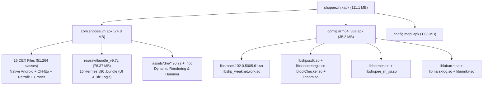
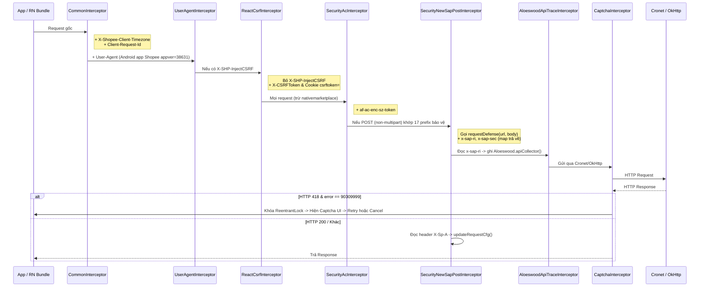
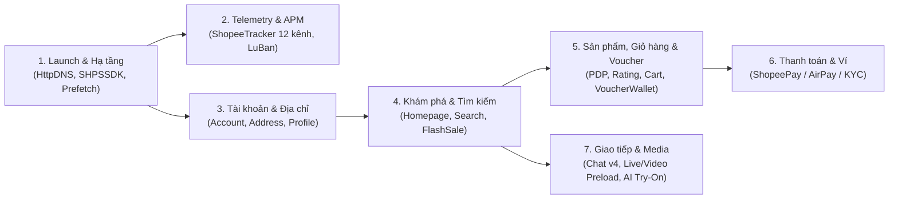

# Báo Cáo Reverse Engineering Chi Tiết: `shopeezin.xapk` (`com.shopee.vn` v3.86.31)

> **Nguyên tắc bằng chứng (Evidence-First):** Mọi cấu trúc tệp, tên lớp, host, endpoint, header, trường payload và điều kiện kích hoạt trong báo cáo này đều được trích xuất trực tiếp từ mã nguồn decompile (`jadx 1.5.7`), tài nguyên XML/JSON, chuỗi bảng HBC v90 (`bundle_v9.7z`) và danh sách thư viện native (`.so`) của tệp `d:\DIZMESHOPEFOOD\APK\shopeezin.xapk`. Tuyệt đối không suy diễn hoặc bịa đặt response/payload không quan sát thấy.

---

## 1. Tổng Quan & Cấu Trúc Tệp `shopeezin.xapk`

### 1.1. Thông tin định danh (từ `manifest.json` & `AndroidManifest.xml`)
- **Package Name:** `com.shopee.vn`
- **Tên ứng dụng:** `Shopee`
- **Phiên bản:** `3.86.31` (`versionCode: 38631`)
- **XAPK Version:** `2`
- **SDK:** `minSdkVersion: 23`, `targetSdkVersion: 36`, `compileSdkVersion: 36`
- **Tổng dung lượng XAPK:** `111,121,045` bytes (~106 MB)
- **Flavor / Region:** `shopeeVietnam` / `vietnam` (`BuildConfig.java`)
- **React Native Lib Version:** `0.63.4.18` (`BuildConfig.RN_LIB_VERSION`)
- **Application Class:** `com.shopee.app.application.ShopeeApplication_`
- **Zygote Preload:** `com.shopee.shpssdk.wvvvuuww` (Shopee Security SDK khởi chạy từ tầng Zygote)
- **Main Launcher Activity:** `com.shopee.app.biz.home.ui.home.HomeActivity`
- **Deeplink Proxy Activity:** `com.shopee.app.biz.deeplink.impl.proxy.ProxyActivity`

### 1.2. Cấu trúc các thành phần bên trong XAPK

```
shopeezin.xapk (ZIP Archive - 5 entries)
├── manifest.json                 (3,623 bytes - Khai báo split APKs, permissions, SDK)
├── icon.png                      (18,799 bytes - Biểu tượng ứng dụng)
├── com.shopee.vn.apk             (74,792,536 bytes - Base APK: 6,184 entries)
│   ├── classes.dex .. classes16.dex (16 tệp DEX, 51,264 lớp Java/Kotlin)
│   ├── assets/                   (372 tệp: .hbc, .json, .model/.license AI, .7z DRE, .bks)
│   │   ├── DataBinding_v9.hbc & HummerDefinition_es5_v9.hbc (Hermes Bytecode v90)
│   │   ├── dre/*.90.7z           (Dynamic Rendering Engine: chatModule, homepageBanners, mePage, notiArItemCard, searchModule)
│   │   └── com.shopee.luban.*.json (Cấu hình các module APM Luban)
│   └── res/
│       ├── raw/bundle_v9.7z      (15,745,454 bytes -> giải nén ra 415 tệp / 76.37 MB)
│       │   ├── *.bundle (16 tệp Hermes Bytecode v90: shopeepay.bundle 20.6MB, product-page.bundle 6.36MB, base73.bundle 5.41MB, base.bundle 5.24MB, homepage.bundle 2.90MB, search-result.bundle 2.78MB, ...)
│       │   └── strings/**/*.json (Tệp đa ngôn ngữ vi/en/km)
│       ├── raw/config.json       (23,653 bytes - Feature flags theo quốc gia)
│       └── xml/network_security_config.xml
├── config.arm64_v8a.apk          (35,247,264 bytes - 172 entries, gồm 167 thư viện native .so)
│   ├── Network: libcronet.102.0.5005.61.so, libshp_weaknetwork.so
│   ├── Security/Anti-Tamper: libshpssdk.so (5.7MB), libshopeeaegis.so (280KB), libtoolChecker.so, libnorn.so, libshadowhook.so, libbytehook.so, libjnihook.so
│   ├── JS/RN Engine: libhermes.so, libhermes-executor-release.so, libshopee_rn_jsi.so, libhummer-hermes_new.so
│   └── Telemetry/Media: libluban-*.so, libmarsxlog.so, libmmkv.so, libffmpegsz.so, libsszmediasdk.so, libSNNEngine.so
└── config.mdpi.apk               (1,081,245 bytes - Tài nguyên đồ họa mật độ mdpi)
```

### 1.3. Sơ đồ kiến trúc tổng thể (Mermaid)



---

## 2. Hạ Tầng Mạng, Hosts & Cơ Chế Bảo Mật / Headers Chung

### 2.1. Danh sách Host Production (Việt Nam)
Trích xuất từ `com/shopee/app/application/shopeetask/appcontext/AppConstantsImpl.java` và `com/shopee/app/BuildConfig.java`:

| Vai trò | Host / Base URL (Live VN) | Nguồn bằng chứng |
|---|---|---|
| **Main API & Mall Base** | `https://mall.shopee.vn/` | `AppConstantsImpl.getUrlBase()` / `getLiveUrlBase()` |
| **Country Domain Base** | `https://shopee.vn/` | `AppConstantsImpl.getCountryDomainBase()` |
| **Custom TCP Connection** | `api.shopee.vn:20346` | `BuildConfig.CONNECTION_URL_LIVE` |
| **BI Tracking (UBT)** | `https://c-api-bit.shopeemobile.com/v4/tr/vn` | `AppConstantsImpl.getBiTrackingServer()` |
| **BI APMS / Patronus** | `https://patronus.idata.shopeemobile.com/event-receiver/api/v4/vn` | `AppConstantsImpl.getBiApmsTrackingServer()` |
| **ShopeeTracker UBT Base** | `https://ubt.tracking.shopee.sg/` (chuyển đổi subdomain thành `apm.`, `dp.`, `ubta.`) | `HttpClientHelper.java` & `URLConvert.java` |
| **Device Fingerprint (SHPSSDK)** | `https://df.infra.sz.shopee.vn` | `AppConstantsImpl.getDigitalSignatureHost()` & `SPSSDKDelegate.java` |
| **HttpDNS / GSLB** | `https://gslb.sgw.shopeemobile.com` | `com/shopee/httpdns/dns/serverconfig/d.java` |
| **File / Image Search TCP** | `f.shopee.vn:18080` | `AppConstantsImpl.getFileTcpServerAddress()` |
| **Image CDN** | `https://cf.shopee.vn/file/` | `AppConstantsImpl.getImageServer()` |
| **Video Play / CDN / Upload** | `https://cv.shopee.vn/`, `https://cvf.shopee.vn/file/`, `https://v.shopee.vn/` | `AppConstantsImpl.getVideo*Server()` |
| **Feedback Content Safety** | `content-safety-api.shopee.vn` | `AppConstantsImpl.getFeedbackImageReportDomain()` |
| **UserStats Server** | `http://userstats.shopee.vn:12030` | `AppConstantsImpl.getUserStatsServer()` |
| **ShopeePay / AirPay GW** | `https://api.gw.airpay.vn`, `https://api.airpay.vn`, `https://app.shopeepay.vn` | DEX strings & `shopeepay.bundle` |

### 2.2. Network Security Config & SSL Pinning
Trong `res/xml/network_security_config.xml`:
- Cho phép cleartext mặc định (`<base-config cleartextTrafficPermitted="true"/>`), ngoại trừ `patronus.idata.shopeemobile.com` (`cleartextTrafficPermitted="false"`).
- **SSL Pinning (SHA-256 `<pin-set>`):** Áp dụng cho các domain tài chính/tín dụng:
  - `finance.scredit.com.my`
  - `sloanseller-admin.scredit.com.my`
  - `sloanseller.scredit.com.my`
  - `uat.scredit.com.my`
- **Root / Tamper Detection:** `AndroidManifest.xml` khai báo `<queries>` kiểm tra hàng loạt gói root/hook như `com.topjohnwu.magisk`, `de.robv.android.xposed.installer`, `com.saurik.substrate`, `com.chelpus.luckypatcher`, `eu.chainfire.supersu`, v.v.

### 2.3. Pipeline Interceptor & Bộ Header Chuẩn Trên Mọi Request



Chi tiết các **Header chung** quan sát được trong code (`com/shopee/app/network/` & `PrefetchBaseApi`):
- `User-Agent`: `Android app Shopee appver=38631` (từ `PrefetchBaseApi.h` / `UserAgentInterceptor`).
- `X-Shopee-Client-Timezone`: Múi giờ thiết bị (`CommonInterceptor`).
- `Client-Request-Id`: ID theo dõi từng request (`CommonInterceptor`, trừ domain trong blacklist).
- `x-api-source`: `"rn"` (khi gọi từ React Native / Prefetch).
- `x-shopee-language`: `"vi"` (từ `AppConstantsImpl.getLanguageTag()`).
- `referer`: `"https://mall.shopee.vn/"`.
- `if-none-match-`: Chữ ký query string tính trực tiếp theo công thức trong `PrefetchBaseApi.g/h`:
  `55b03-` + `MD5("55b03" + MD5(query_string) + "55b03")`.
- `X-CSRFToken` & `Cookie: ...;csrftoken=<val>;`: Tự động tiêm bởi `ReactCsrfInterceptor` khi request có cờ `X-SHP-InjectCSRF`.
- `af-ac-enc-sz-token`: Tiêm bởi `SecurityAcInterceptor` (`com/shopee/app/network/a.java`).
- `x-sap-ri`, `x-sap-sec` (và các header từ `requestDefense`): Tiêm bởi `SecurityNewSapPostInterceptor` (`com/shopee/app/network/antifraud/d.java`) cho các request `POST` (không phải multipart) khớp 17 prefix trong `com/shopee/app/network/antifraud/util/a.java`:
  `api/`, `/wallet/v`, `/spba/`, `/kyc/`, `/apba/`, `/wss/`, `/transaction_history/`, `/merchant_wallet_service/`, `/wse/`, `/payment/`, `/user/`, `/user_wallet_engine/`, `/acquiring/`, `/base/`, `/promotion/`, `/spp/`, `/credit/` (cùng `/v4/tss/` trên `ubt.tracking.*` và `api.gw.*airpay.*` / `wallet.airpay.*`).

---

## 3. Phân Tích Chi Tiết Các Nhóm API Có Trong `shopeezin.xapk`

### Tổng quan phân nhóm theo vòng đời & module



---

### Nhóm 1: Khởi Tạo, Hạ Tầng Mạng & Bảo Mật (Launch, HttpDNS, Anti-Fraud, Prefetch)

#### 1.1. HttpDNS Server Config (`GET https://gslb.sgw.shopeemobile.com/{appId}/configs?timestamp={ts}`)
- **Nguồn bằng chứng:** `com/shopee/httpdns/dns/serverconfig/d.java` (dòng 142–168).
- **Method & URL:** `GET https://gslb.sgw.shopeemobile.com/{aVar.a}/configs?timestamp={unix_sec}`
- **Headers:** Các header ký từ `com.shopee.httpdns.network.b.a.a(url, null)` (HMAC/signature nội bộ của HttpDNS SDK).
- **Payload / Query:** `timestamp` (Unix timestamp tính bằng giây).
- **Mục đích thu thập / trả về:** Lấy danh sách IP máy chủ HttpDNS (`arrayList`) và cấu hình phân giải tên miền GSLB.
- **Khi nào kích hoạt:** Khi khởi động SDK `HttpDNS` ở giai đoạn app launch để cập nhật cấu hình server GSLB.

#### 1.2. HttpDNS Resolve (`GET https://{dns_ip}/{appId}/resolve?timestamp={ts}&hosts={hosts}`)
- **Nguồn bằng chứng:** `com/shopee/httpdns/dns/resolver/h.java` (dòng 79–112).
- **Method & URL:** `GET https://{str2}/{aVar.a}/resolve?timestamp={unix_sec}&hosts={comma_separated_domains}`
- **Headers:** Header từ `com.shopee.httpdns.network.b.a.a(str4, null)` + `Host: <httpdns host>`.
- **Query Params:** `timestamp` (giây), `hosts` (danh sách domain cần phân giải, ví dụ `mall.shopee.vn`).
- **Mục đích:** Phân giải trực tiếp IP của các domain Shopee nhằm tránh DNS hijacking / giảm độ trễ.
- **Khi nào kích hoạt:** Khi khởi chạy app (preload `mall.shopee.vn` từ `AppConstantsImpl.getHttpdnsPreloadDomains()`) hoặc khi cache DNS hết hạn / có domain mới cần resolve.

#### 1.3. Shopee Security SDK — Device Fingerprint (`https://df.infra.sz.shopee.vn`)
- **Nguồn bằng chứng:** `com/shopee/app/biz/launch/impl/util/tongdun/SPSSDKDelegate.java` (dòng 222–237), `AppConstantsImpl.getDigitalSignatureHost()`, `libshpssdk.so`.
- **Base URL:** `https://df.infra.sz.shopee.vn` (có thể override qua remote config `shopee_security_sdk_hosts.digitalSignatureSdkFingerprintHost`).
- **Tham số khởi tạo SDK:** `appId = 1001`, `cldNo = 484964812510L`, `appendingData = <device/user appending string>`.
- **Headers & Payload chi tiết:** Được đóng gói/mã hóa bên trong thư viện native `libshpssdk.so` (không lộ plaintext path trong Java).
- **Mục đích:** Thu thập dấu vân tay thiết bị (device fingerprint / risk token) phục vụ chống gian lận. Sau khi lấy token thành công (`onGetRiskTokenSuccess`), app tự động đẩy thêm event UBT `operation="action_dfp_report"`, `target_type="report_dfp"`, `data={"dfp": token}`.
- **Khi nào kích hoạt:** Tự động kích hoạt ngay trong quá trình khởi chạy ứng dụng (`launch`).

#### 1.4. Prefetch Microsite / Landing Page (`POST https://mall.shopee.vn/api/v4/traffic/page_component/get_microsite_page`)
- **Nguồn bằng chứng:** `com/shopee/app/biz/launch/impl/ui/prefetch/data/repo/remote/microsite/a.java` (dòng 36–321) và `b.java` (dòng 102–221).
- **Query Params:** `native_prefetch=true` (nếu `aVar.a == true`).
- **Headers:**
  - `x-api-source: rn`
  - `x-shopee-language: vi`
  - `referer: https://mall.shopee.vn/`
  - `user-agent: Android app Shopee appver=38631`
  - `if-none-match-: 55b03-<md5>`
  - `Content-Type: application/json; charset=utf-8`
  - `Accept: application/json`
  - `X-CSRFToken: <csrf>` (nếu có)
  - `x-sap-ri`, `x-sap-sec`, `af-ac-enc-sz-token` (qua interceptor chuỗi OkHttp)
- **Payload JSON:** `platform` (`"mobile"`), `version` (`"2024.07.v3"`), `device_height` (dp), `item_card_version` (`"ic_v3"`), `latitude`, `longitude`, `extra_params`, `query_params` (`downstream_params`, `preserve_order_items`, ...).
- **Mục đích & Kích hoạt:** Tải trước (prefetch) cấu trúc component của trang Microsite/Campaign ngay khi người dùng bấm vào deeplink hoặc điều hướng tới trang chiến dịch.

---

### Nhóm 2: Telemetry, Tracking & APM (`ShopeeTracker` & `LuBan SDK`)

#### 2.1. ShopeeTracker Batch Ingestion (`POST https://ubt.tracking.shopee.sg/...` & `c-api-bit.shopeemobile.com/v4/tr/vn`)
- **Nguồn bằng chứng:** `com/shopee/shopeetracker/eventhandler/sender/SendEventAPI.java`, `f.java`, `URLConvert.java`, `EventSenderManager.java`, `EventSendScheduler.java`, `EventDataSource.java`.
- **Headers:**
  - `X-SPC-DF: <DeviceInfoManager.INSTANCE.getFingerPrint()>` (`f.java:258`)
  - `Content-Type: application/json`
  - `Content-Encoding: zstd` (ưu tiên `ZstdUtils.compress`) hoặc `gzip` (`GzipUtil.createGzip`)
  - Với nhánh `/v4/tss/`: đi qua `SecurityNewSapPostInterceptor` (`x-sap-ri`, `x-sap-sec`).
- **Payload JSON (`EventDataSource`):** Mảng các sự kiện chứa: `operation`, `page_type`, `page_section`, `target_type`, `target_type_ext`, `target_property`, `target_property_ext`, `position_id`, `pub_id`, `pub_context_id`, `tracker_id`, `be_group_id`, `real_time_type`, `ads_info`, `item_info`, `data` (Map tùy biến).
- **11 kênh chuyển đổi URL trong `URLConvert.java`:**
  - `UBTSender` (type 6): giữ nguyên `trackingUrl` (`/v4/event_batch`) — hành vi người dùng chuẩn.
  - `RealtimeSender` (type 7): `ubt.` → `ubta.` — sự kiện thời gian thực.
  - `APMSender` (type 3): `ubt.` → `apm.` — hiệu năng.
  - `DataPointSender` (type 4): `ubt.` → `dp.` — điểm dữ liệu phân tích.
  - `UBTAffiliateSender` (type 8): `/event_batch` → `/tss/affiliate/event_batch`.
  - `UBTActionInstallSender` (type 9): `/event_batch` → `/tss/install/event_batch`.
  - `UBTActionInstallRealtimeSender` (type 10): `ubt.` → `ubta.` + `/tss/install/event_batch`.
  - `AdsSender` (type 11): `ubt.` → `ubta.` + `/sac/event_batch` — tracking quảng cáo.
  - `BurstSender` (type 12): `/v4/event_batch` → `/burst/v4/event_batch`.
  - `ClipSender` (type 13): `ubt.` → `dp.` + `/v4/profile/event_batch`.
  - `AlbumSender` (type 14): `ubt.` → `dp.` + `/v4/profile/v2/event_batch`.
- **Khi nào kích hoạt:** `EventSendScheduler` chạy định kỳ sau `INIT_DELAY = 3s`, chu kỳ mặc định `40s` (backoff tối đa `600s` khi lỗi), hoặc gọi `sendDataImmediately()` với sự kiện realtime.

#### 2.2. LuBan APM / Patronus (`https://patronus.idata.shopeemobile.com/...`)
- **Nguồn bằng chứng:** `com/shopee/luban/common/constant/e.java`, `com/shopee/luban/module/power/upload/f.java`, `AppExitInfo.java`, `DreErrorInfo.java`, `RnCrashInfo.java`, `RnCrash2Info.java`, `DeviceTypeRequestInfo.java`.
- **Các Endpoint có thật:**
  1. `POST /receiver/api/v1/receiver/android/{appId}/{region}/signature` (`e.java:33`) — Báo cáo lỗi/APM chuẩn (AppExit, ANR, Block, CPU, IO, Memory, Stacklens, DeviceLabel).
  2. `POST /receiver/api/v1/receiver/android/power_consumption/{appId}/upload` (`power/upload/f.java:21`) — Báo cáo tiêu thụ pin/năng lượng.
  3. `POST /dre-receiver/api/v1/receiver/dre/android/{appId}/{region}/...` (`DreErrorInfo.java:116`) — Báo cáo lỗi Dynamic Rendering Engine (DRE).
  4. `POST /rn-receiver/api/v1/receiver/rn/android/{appId}/...` & `/rn-crash-receiver/api/v1/receiver/rn/android/{appId}/{region}/...` (`RnCrashInfo.java`, `RnCrash2Info.java`) — Báo cáo crash/JS framegraph từ React Native.
- **Dữ liệu thu thập (ví dụ `DeviceTypeRequestInfo`):** `appVersion`, `cachedDeviceType`, `cpuArchs`, `cpuMaxFreq`, `cpuModel`, `cpuCoreCnt`, `deviceId`, `deviceModel`, `deviceMemory`, `deviceDisk`, `osType`, `osVersion`, `lastUpdateTimestamp`, `triggerInterval`, `triggerSource`, `extraData`.
- **Khi nào kích hoạt:** Tự động kích hoạt khi phát hiện crash (Java/Native/RN), ANR, AppExit, lỗi DRE hoặc theo lịch lấy mẫu hiệu năng/pin của `LuBanSDK`.

---

### Nhóm 3: Tài Khoản, Xác Thực & Địa Chỉ (`user-data.bundle`, `base.bundle`, `main.bundle`)

*(Trích xuất từ chuỗi HBC v90 sạch trong `bundle_v9` và `prefetch/data/repo/remote/payment/a.java`)*

| Endpoint | Nguồn bằng chứng | Mục đích & Thời điểm kích hoạt |
|---|---|---|
| `GET https://mall.shopee.vn/api/v4/account/basic/get_payment_info` | `prefetch/.../payment/a.java` & `user-data.bundle` | Lấy thông tin thanh toán cơ bản của tài khoản. Kích hoạt khi prefetch lúc mở app/vào luồng thanh toán (có `x-api-source: rn`, `if-none-match-`, `referer`). |
| `/api/v4/account/basic/get_account_info` | `user-data.bundle`, `base.bundle` | Lấy thông tin hồ sơ tài khoản đang đăng nhập. Kích hoạt khi mở app / vào tab Tôi (Me). |
| `/api/v4/account/address/get_user_address_list` | `user-data.bundle`, `base.bundle` | Lấy danh sách địa chỉ nhận hàng của người dùng. Kích hoạt khi vào Sổ địa chỉ, PDP (tính phí ship), hoặc Checkout. |
| `/api/v4/account/address/get_user_address_detail` | `user-data.bundle` | Lấy chi tiết một địa chỉ cụ thể. Kích hoạt khi mở form sửa địa chỉ. |
| `/api/v4/account/address/get_user_address_flag` | `user-data.bundle` | Kiểm tra cờ trạng thái địa chỉ (mặc định/hợp lệ). |
| `/api/v2/user/profile/update` | `user-data.bundle`, `base.bundle` | Cập nhật thông tin hồ sơ cá nhân. Kích hoạt khi bấm Lưu ở trang Sửa hồ sơ. |
| `/api/v2/user/access_token/get/` | `base.bundle` | Lấy/làm mới access token phiên người dùng. |
| `/api/v2/user/email/update/` & `/api/v2/user/phone/update/` | `base.bundle` | Cập nhật email / số điện thoại tài khoản. |
| `/api/v2/otp/send/` & `/api/v2/security_measures/check_otp/` | `base.bundle` | Gửi và xác thực mã OTP khi đăng nhập hoặc thay đổi thông tin nhạy cảm. |

> *Lưu ý bằng chứng:* Với các endpoint chỉ nằm trong Hermes bytecode (`.bundle`), tên path và bộ header (`X-API-SOURCE`, `X-CSRFToken`, `X-SHP-InjectCSRF`, `X-XSRF-TOKEN`) được xác nhận trực tiếp từ bảng chuỗi HBC v90; cấu trúc JSON body chi tiết nằm trong bytecode hàm JS chưa giải mã.

---

### Nhóm 4: Trang Chủ, Tìm Kiếm & Khám Phá (`homepage.bundle`, `search.bundle`, `search-result.bundle`)

- **Headers quan sát trong bundle:** `X-API-SOURCE`, `X-API-SRC-LIST`, `X-CSRFToken`, `X-SHP-InjectCSRF`, `X-SAP-Type`, `x-phone-brand`, `x-phone-model`, `x-request-id`.
- **Các nhóm endpoint có thật:**
  - **Trang chủ & Gợi ý:** `/api/v2/daily_discover/get`, `/api/v2/recommendation/all_category`, `/api/v2/recommendation/bundle/daily_discover_main`, `/api/v2/recommendation/bundle/daily_discover_category`, `/api/v4/recommend/recommend`, `/api/v4/recommend/recommend?bundle=nsrp_trending_search&offset=`.
  - **Flash Sale & Flash Voucher:** `/api/v2/flash_sale/flash_sale_get_items`, `/api/v2/flash_sale/flash_sale_batch_get_items`, `/api/v2/flash_sale/brand_sale_get_all_sessions`, `/api/v2/flash_sale/brand_sale_get_items`, `/api/v2/flash_voucher/get_all_sessions`, `/api/v2/flash_voucher/batch_get_vouchers`.
  - **Tìm kiếm (Search & Search Result):**
    - `/api/v4/search/search_hint` & `/api/v2/search_hint/get` — Gợi ý từ khóa khi gõ vào thanh tìm kiếm.
    - `/api/v4/search/trending_search?bundle=popsearch&limit=` — Từ khóa tìm kiếm thịnh hành khi chạm vào ô tìm kiếm.
    - `/api/v4/search/search_suggestion?scene=sdp` — Gợi ý tìm kiếm theo ngữ cảnh.
    - `/api/v4/search/search_items` & `/api/v2/search_items/` — Truy vấn danh sách sản phẩm theo từ khóa & bộ lọc.
    - `/api/v4/search/search_facet`, `/api/v4/search/search_filter_config`, `/api/v4/search/location_filter` — Lấy cấu hình bộ lọc kết quả tìm kiếm.
    - `/api/v4/search/search_user` & `/api/v2/search_users` — Tìm kiếm shop/người dùng.
    - `/api/v4/search/curated_search` & `/api/v4/search/get_ymal_items` — Tìm kiếm biên tập & sản phẩm tương tự.
  - **Kích hoạt:** Khi mở tab Trang chủ, cuộn Daily Discover, chạm thanh Tìm kiếm, gõ từ khóa, hoặc nhấn Tìm kiếm / đổi bộ lọc.

---

### Nhóm 5: Chi Tiết Sản Phẩm (PDP), Giỏ Hàng, Shop & Voucher (`product-page.bundle`, `ads-landing-page.bundle`, `an-landing-page.bundle`)

- **Bằng chứng kết hợp Native Prefetch (`e.java:93`) + Hermes Bundles:**
  - **Chi tiết sản phẩm & Prefetch PDP:**
    - `/api/v4/pdp/get` (nằm trong `e.java` map type `1` — prefetch ngay khi người dùng bấm vào thẻ sản phẩm, gửi kèm `cached_address_*` từ `pdp/a.java`).
    - `/api/v4/pdp/cart_panel/get` (`e.java` list `f` — tải trước bảng chọn phân loại hàng / thêm vào giỏ).
    - `/api/v4/pdp/get_shipping` & `/api/v4/pdp/get_shipping_info` — Tính phí vận chuyển theo địa chỉ.
    - `/api/v4/pdp/buy_now/validate_checkout` — Kiểm tra điều kiện Mua ngay.
    - `/api/v4/item/get`, `/api/v4/item/get_list`, `/api/v2/item/get_rating`, `/api/v2/item/get_rating_tagfilters`, `/api/v2/like_item_rating` — Lấy thông tin item, đánh giá và lọc tag đánh giá.
  - **Giỏ hàng & Checkout Pre-warm:**
    - `/api/v4/cart/add_to_cart`, `/api/v4/cart/add_to_cart_batch`, `/api/v4/cart/cart_panel/get`, `/api/v2/cart/get_orders`, `/api/v2/cart/get_recommend_items`.
    - `/api/v4/cart/checkout` (mặc định trong `RequestPreWarmConfig` tại `com/shopee/app/network/api/o.java:67`).
  - **Landing Page Quảng cáo & Affiliate (`ads-landing-page.bundle`, `an-landing-page.bundle`, `e.java:93`):**
    - `/api/v1/opaanlp/item_info`, `/api/v1/opaanlp/item_category`, `/api/v1/opaanlp/claim_new_user_voucher`, `/api/v1/opaanlp/hot_picks` (type `2` trong prefetch).
    - `/api/v1/opalp/item_info`, `/api/v1/opalp/pf_image`, `/api/v2/opalp/hot_picks`, `/api/v1/opalp/claim_nuv` (type `3` trong prefetch).
  - **Voucher Wallet & Shop:**
    - `/api/v2/voucher_wallet/get_user_voucher_list`, `/api/v2/voucher_wallet/save_voucher`, `/api/v2/voucher_wallet/save_shop_voucher`, `/api/v4/voucher_wallet/validate_voucher_drawer`, `/api/v4/voucher_wallet/calculate_min_spend_for_floating_counter`.
    - `/api/v4/shop/get_shop_detail`, `/api/v4/shop/get_categories`, `/api/v4/shop/follow`, `/api/v4/shop/unfollow`.

---

### Nhóm 6: Chat, Live/Video & AI Try-On (`com.shopee.app.biz.chat`, `com.shopee.sz`)

#### 6.1. Shopee Chat v4 (`com/shopee/app/biz/chat/impl/network/http/api/a.java` & `b.java`)
Tất cả là `POST` với JSON body:
1. `POST /api/v4/chat/get_conversation_list_by_filters` (`GetBizConversationListByFilterRequest`):
   - **Payload:** `biz_ids` (List<Integer>), `conv_filter_type` (int), `cursor` (`BizConversationSyncCursor`), `limit` (int), `need_biz_conv_info` (boolean), `on_message_received` (boolean), `biz_conv_info_option`, `user_shop_id` (Long), `start_from_old` (boolean).
   - **Kích hoạt:** Mở hộp thư Chat hoặc lọc hội thoại.
2. `POST /api/v4/chat/get_message_contents` (`GetBizMessageByIdsRequest`):
   - **Payload:** `biz_id` (int), `chat_request_scenario` (int), `format` (int), `msgids` (List<String>).
   - **Kích hoạt:** Mở một phòng chat cụ thể để tải nội dung tin nhắn theo ID.
3. `POST /api/v4/chat/get_conversation_list_by_ids` — Tải hội thoại theo danh sách ID.
4. `POST /api/v4/chat/get_updated_conversation` — Đồng bộ hội thoại có cập nhật mới.
5. `POST /api/v4/chat/read_conversation` & `POST /api/v4/chat/unread_conversation` — Đánh dấu đã đọc / chưa đọc.
6. `POST /api/v4/chat/mute_conversation` & `POST /api/v4/chat/unmute_conversation` — Tắt / bật thông báo hội thoại.
7. `POST /api/v4/chat/clear_conversation` — Xóa lịch sử hội thoại.
8. `POST /api/v4/chat/check_broadcast_whitelist` (`b.java:21`) — Kiểm tra quyền gửi tin nhắn broadcast.

#### 6.2. Live / Video Preload (`com/shopee/sz/luckyvideo/common/networkpreload/api/g.java` & `e.java`)
- `POST /api/v2/preload/info`
- **Headers (Retrofit `@Header`):** `totalMemory` (long), `totalStorage` (long), `availableStorage` (long).
- **Payload JSON:** `preload_keys` (List), `shopee_df` (String — device fingerprint).
- **Kích hoạt:** Khi chuẩn bị phát video / Shopee Live để lấy thông tin preload theo cấu hình phần cứng thiết bị.

#### 6.3. AIGC Try-On (`com/shopee/sz/luckyvideo/mediasdk/datasource/aitryon/b.java`)
- `GET /aigc/app/api/v1/tryOn/models` (`pageContext`, `pageSize`) — Danh sách model thử đồ AI.
- `GET /aigc/app/api/v1/tryOn/model` (`modelId`) — Chi tiết model.
- `GET /aigc/app/api/v1/tryOn/shop/itemImages` & `GET /aigc/app/api/v1/tryOn/productEntities` (`pageContext`, `pageSize`).
- `POST /aigc/app/api/v1/tryOn/task/create` & `GET /aigc/app/api/v1/tryOn/task/query` (`taskId`) — Tạo và polling kết quả tác vụ thử đồ AI.
- `POST /aigc/app/api/v1/tryOn/image/detect` & `POST /aigc/app/api/v1/tryOn/productEntity/remove` & `GET /aigc/app/api/v1/tryOn/backgrounds`.

---

### Nhóm 7: Thanh Toán & Ví ShopeePay / AirPay (`shopeepay.bundle`, `com.shopee.shopeepaysdk`)

- **Hosts quan sát trong `shopeepay.bundle`:** `https://api.airpay.vn`, `https://api-shopee.airpay.vn/wallet`, `https://api.gw.airpay.vn`, `https://app.shopeepay.vn/u/checkout_vn`.
- **Headers đặc thù trong `shopeepay.bundle`:**
  - Auth & Security: `X-Token`, `X-CSRFToken`, `X-SHP-InjectCSRF`, `X-SAP-Type`, `X-SPC-DF`, `X-Airpay-ClientId`, `X-Airpay-Req-T`, `X-SPM-TP-AT`, `X-SPM-TP-Nonce`, `X-Kredit-Req-APPID`, `X-Kredit-Req-AuthCode`, `X-Kredit-Req-H`, `X-Kredit-Req-Nonce`, `X-Kredit-Req-Spp-Nonce`, `X-Kredit-Start-Timestamp`.
  - Telemetry thiết bị & vị trí: `X-Device-Id`, `X-Device-OS`, `X-device-brand`, `X-device-model`, `X-app-OS-version`, `X-app-version-name`, `X-latitude`, `X-longitude`, `X-network-type`, `X-os-type`, `X-platform`, `X-sdk-version`, `X-country`, `X-FE-Trace-Id`, `X-Timestamp-Ms`.
- **Các nhóm endpoint chính (468 paths trong `shopeepay.bundle`, mẫu tiêu biểu):**
  - **Khởi tạo & Thanh toán:** `/api/payment/init`, `/api/payment/pay`, `/api/payment/pay_again`, `/api/payment/poll`, `/api/payment/get_result_page`, `/api/payment/paymentconfig`, `/api/payment/threeds_verify_notify`, `/api/payment/transaction/init`, `/api/payment/transaction/init_payment`, `/api/payment/transaction/confirm_payment_channel`.
  - **Quản lý Kênh & Thẻ / Ngân hàng:** `/api/payment/channel_item/item_list`, `/api/payment/channel_item/bank_list`, `/api/payment/channel_item/add/`, `/api/payment/channel_item/delete/`, `/api/payment/channel_item/set_default/`, `/api/wallet/cards/`, `/api/wallet/cards/account/check_otp`, `/api/v2/bank_account/delete`.
  - **eKYC & Ví AirPay / ShopeePay:** `/api/kyc`, `/api/server/apw/v1/ekyc/get_banks`, `/api/server/apw/v1/ekyc/linking_init`, `/api/v2/wallet/overview`, `/api/v2/wallet/v2/buyer/airpay_wallet/auto_topup/config/get`.
  - **QR & Chuyển tiền:** `/api/v2/qr/b-scan-c/get`, `/api/v2/qr/cashin_topup/ticket/create`, `/api/v2/transfer/contact/list`.
- **Khi nào kích hoạt:** Khi người dùng mở Ví ShopeePay, thực hiện liên kết ngân hàng/eKYC, quét mã QR, chuyển tiền hoặc thanh toán đơn hàng tại bước Checkout.

---

## 4. Tóm Tắt Phạm Vi Đã Xác Minh & Giới Hạn Static Analysis

- **Đã xác minh 100% từ mã nguồn Java/Kotlin (`jadx`) + HBC v90 (`bundle_v9.7z`) + `AndroidManifest.xml`:** Cấu trúc split XAPK, toàn bộ production hosts VN, chuỗi interceptor & công thức header (`if-none-match-`, `x-sap-ri`, `af-ac-enc-sz-token`, `X-CSRFToken`, `X-SPC-DF`), cơ chế Captcha HTTP `418` (`90309999`), toàn bộ 11 kênh ShopeeTracker, các endpoint LuBan/Patronus, HttpDNS, Chat v4, Live Preload, AI Try-On, Microsite/PDP Prefetch và danh mục endpoint trong 16 React Native Hermes bundles.
- **Giới hạn static analysis (không suy diễn):** Các endpoint nằm thuần trong 16 tệp Hermes bytecode (`.bundle`) và thư viện native `libshpssdk.so` (5.7 MB) không hiển thị trực tiếp schema JSON body/response ở dạng Java DTO như các module native; để lấy full JSON request/response thực tế của các màn hình RN hoặc payload mã hóa của `libshpssdk.so`, cần kết hợp dynamic instrumentation (Frida/MITM trên thiết bị test) ở bước tiếp theo.
